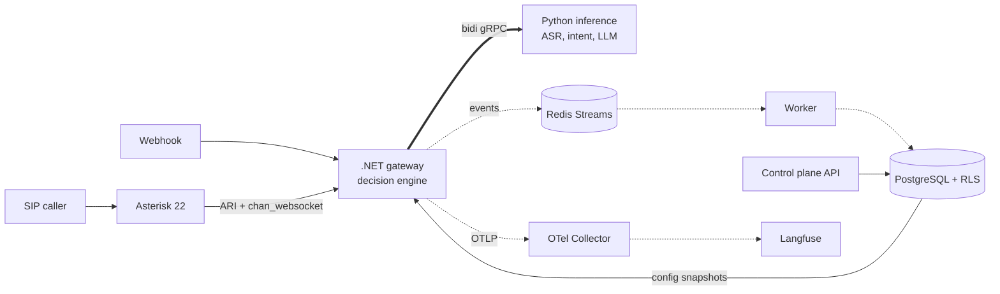

# Switchboard

A multi-tenant AI router for voice calls and messages. A SIP call or WhatsApp-style message comes in, Switchboard works out what the person wants, asks a clarifying question if it has to, and routes to the right department for that tenant.

All tenants and data are fictional. **This is not an emergency service:** the emergency class exists to demonstrate asymmetric misroute costs.



## The ideas worth reading

- **Decisions minimise expected misroute cost,** using calibrated probabilities and a cost matrix, not a top-1 confidence threshold. At 70% between billing and sales, routing is fine because a wrong guess is cheap. At 90% on an appointment with 10% on emergency, it isn't. See `DecisionEngine.cs` and `docs/adr/0002`.
- **Invariants are rules, not costs.** Property tests showed expected cost alone sends a 6% emergency to voicemail, so a hard guard sits on top.
- **Python scores; .NET decides.** Routing policy lives in one place, and still works when inference is down.
- **Isolation is proved adversarially.** `scripts/mutation_check.py` removes each control in turn and requires a named test to fail. It found real gaps.
- **Degradation is designed.** Each dependency has a defined failure mode, tested by stopping it during a real SIP call.
- **The failures are written down.** [docs/failure-log.md](docs/failure-log.md) has the real ones, including the design's own.

## Status

**Everything that can run without paid keys or human reviewers has been run.** The evidence is in [docs/REPORT.md](docs/REPORT.md), and every number there is generated.

| Works and is tested on real infrastructure | Written and tested against fakes only | Needs credentials or people |
|---|---|---|
| Real SIP calls through Asterisk, including real speech into Whisper | | isiZulu quality on telephone audio |
| Whisper failover when Deepgram is unreachable | LLM fusion in a real cascade, and speculative calls in the gateway | LLM-only and cascade results on reportable data |
| Decision engine in .NET and Python, with shared vectors | Open-weight data generator | Reportable data and native-speaker review |
| Row-level security, API, isolation suite, mutation check | | Encoder bake-off, which needs that data and a GPU |
| Webhook signatures, dedup and tenancy | | The pre-registered `T_route` on live ASR |
| Failure injection, link chaos and load testing | | Sealed test evaluation |
| Per-tenant trace sinks, and traces in self-hosted Langfuse | | Licensed isiZulu and Afrikaans voices |
| Encoder training, ONNX export, quantising and trimming, as a code check | | |
| LLM client against the live API, with latency measured | | |
| Deepgram on real SIP calls, using synthetic speech | | |

The main accuracy, cost and latency claims are still open, and the test split is sealed. **Fixture numbers test the pipeline and aren't results.**

## Run it

Needs Docker, the .NET 10 SDK and [uv](https://docs.astral.sh/uv/). The Asterisk image builds from source, which takes a while the first time.

```sh
cp .env.example .env              # then set real values
uv sync --python 3.12
uv run poe proto
uv run poe prompts                # needs: docker build -t switchboard/tools deploy/tools
uv run poe stack-up
uv run poe seed
uv run poe e2e                    # five tenants on real SIP calls, the webhook path, canary scans
```

| Command | What it does |
|---|---|
| `uv run poe ci` | Lint, tests, isolation suite, fixture eval, the gate and its self-test |
| `uv run poe mutation` | Removes each control and requires a test to fail (slow) |
| `uv run poe failure` | Stops inference, Postgres and Redis during real calls |
| `uv run poe chaos` | Adds latency and throttling on the inference link |
| `uv run poe traces` | Proves spans stay in their own tenant's sink |
| `uv run poe real-asr` | Real speech into Whisper, Deepgram failover, early commit |
| `uv run poe load` | Open-loop SIP load |
| `uv run poe ablate` | Offline gate, training-size, noise and prefix ablations |
| `uv run poe report` | Regenerates `docs/REPORT.md` |

`poe real-asr` also needs `poe train-tfidf` and the ML extras (`uv sync --extra whisper --extra onnx`).

### With credentials

Put keys in `.env`. These spend real money, and each has a spend cap or a small default size:

| Command | Answers |
|---|---|
| `scripts/spike_deepgram_language.py` | Does isiZulu work on telephone audio? The assumption most likely to change the design |
| `scripts/spike_llm_latency.py` | Does an LLM fit the latency budget? |
| `scripts/make_sapi_clips.py` | Synthetic clips for the next command, using Windows voices. Latency only |
| `bench/live_ablations.py` | Endpointing against premature routing, what region is worth, and the head start speculative calls could get |
| `uv run poe live-call` | Real SIP calls through live Deepgram, with an estimated time to route |
| `uv run poe live-eval` | LLM-only and cascade arms, with answers cached |
| `python -m switchboard_inference.data.generate` | Reportable data from an open-weight model |

## Layout

```text
proto/          gRPC and event contracts
configs/        cost matrix, tenants, lexicon, prompts, LLM settings
src/dotnet/     Domain (pure), Storage (RLS), Api, Gateway, Worker
src/python/     inference server, ASR, intent, LLM, data, evals, training
tests/          dotnet (unit, isolation, architecture), python, e2e
deploy/         Compose, Asterisk, SIPp, OTel Collector, Langfuse
bench/          load and stage benchmarks
docs/           metrics, rubric, ADRs, model and data cards, failure log, report, evidence
```

## Limits

- No real SIP trunk, WhatsApp API or customers. The SIP network is private, with no outbound route. Testing uses SIPp inside the Compose network. A softphone would need an RTP range published and an external media address set.
- **No tested LLM fits the 550 ms reserve.** On a live call, a synchronous escalation would hit its deadline and fall back to clarifying. Speculative calls don't recover it: on synthetic speech with live Deepgram partials, even the upper bound rarely gives a median Haiku answer enough head start. See entry 16 in the failure log.
- Whisper has no isiZulu or isiXhosa, so the fallback is a declared degraded mode with a keypad menu. On CPU it also won't reliably meet a 1.5 s budget.
- Prompts use a robotic stand-in voice, and isiZulu prompts are spoken with an English voice.
- The rubric and the isiZulu and Afrikaans phrases haven't had human or native-speaker review.
- Design differences from the original intent are listed in `docs/adr/0003`.
