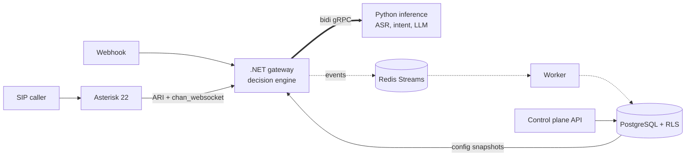

# Switchboard

A multi-tenant AI router for voice calls and messages. A SIP call or WhatsApp-style message comes in, Switchboard works out what the person wants, asks a clarifying question if it has to, and routes to the right department for that tenant.

All tenants and data are fictional. **This is not an emergency service:** the emergency class exists to demonstrate asymmetric misroute costs.



## The ideas worth reading

- **Decisions minimise expected misroute cost,** using calibrated probabilities and a cost matrix, not a top-1 confidence threshold. At 70% between billing and sales, routing is fine because a wrong guess is cheap. At 90% on an appointment with 10% on emergency, it isn't. See `DecisionEngine.cs` and `docs/adr/0002`.
- **Invariants are rules, not costs.** Property tests showed expected cost alone sends a 6% emergency to voicemail, so a hard guard sits on top. See `docs/failure-log.md`.
- **Python scores; .NET decides.** Routing policy lives in one place, and still works when inference is down.
- **Isolation is proved adversarially.** `scripts/mutation_check.py` removes each control in turn and requires a named test to fail.
- **Degradation is designed.** Each dependency has a defined failure mode, tested by stopping it during a real SIP call.

## Status

Evidence so far is in [docs/REPORT.md](docs/REPORT.md), and every number there is generated.

| Works and is tested | Written, not yet run for real | Not done |
|---|---|---|
| Decision engine in .NET and Python, with shared vectors | Deepgram adapter (no API key used yet) | Encoder training and bake-off |
| Row-level security, API, isolation suite, mutation check | Whisper fallback (needs its model) | LLM and Deepgram spikes |
| Real SIP calls through Asterisk with replay ASR | LLM client (tested against a fake transport only) | Native-speaker review of generated data |
| Webhook path with signatures and dedup | Encoder training and ONNX export | Pre-rendered voice prompts (tones for now) |
| Failure injection for inference, Postgres and Redis | OTel Collector config for Langfuse | Sealed test evaluation and `T_route` |
| Stage timings on every decision event | | Span export from the services to that Collector |

The main accuracy, cost and latency claims are still open: they need real generated data and live API runs. **Fixture numbers test the pipeline and aren't results.**

## Run it

Needs Docker, the .NET 10 SDK and [uv](https://docs.astral.sh/uv/). The Asterisk image builds from source, which takes a while the first time.

```sh
cp .env.example .env              # then set real values
uv sync --python 3.12
uv run poe proto
uv run poe stack-up
uv run poe seed
uv run poe e2e                    # five tenants on real SIP calls, the webhook path, canary scans
uv run poe failure                # stops each dependency during a call
```

| Command | What it does |
|---|---|
| `uv run poe ci` | Lint, tests, isolation suite, fixture eval, the gate and its self-test |
| `uv run poe mutation` | Removes each control and requires a test to fail (slow) |
| `uv run poe load` | Open-loop SIP load with replay ASR |
| `uv run poe report` | Regenerates `docs/REPORT.md` from `runs/` |

With API keys in `.env`, `scripts/spike_deepgram_language.py` and `scripts/spike_llm_latency.py` answer the two questions most likely to change the design: whether isiZulu works on telephone audio, and whether an LLM fits the latency budget. Both spend real money.

## Layout

```text
proto/          gRPC and event contracts
configs/        cost matrix, tenants, lexicon, LLM settings
src/dotnet/     Domain (pure), Storage (RLS), Api, Gateway, Worker
src/python/     inference server, ASR, intent, LLM, data, evals, training
tests/          dotnet (unit, isolation, architecture), python, e2e
deploy/         Compose, Asterisk, SIPp, OTel Collector
bench/          load and stage benchmarks
docs/           metrics, rubric, ADRs, model and data cards, failure log, report
```

## Limits

- No real SIP trunk, WhatsApp API or customers. The SIP network is private, with no outbound route.
- Whisper has no isiZulu or isiXhosa, so the fallback is a declared degraded mode with a keypad menu.
- The rubric and the isiZulu and Afrikaans phrases haven't had human or native-speaker review.
