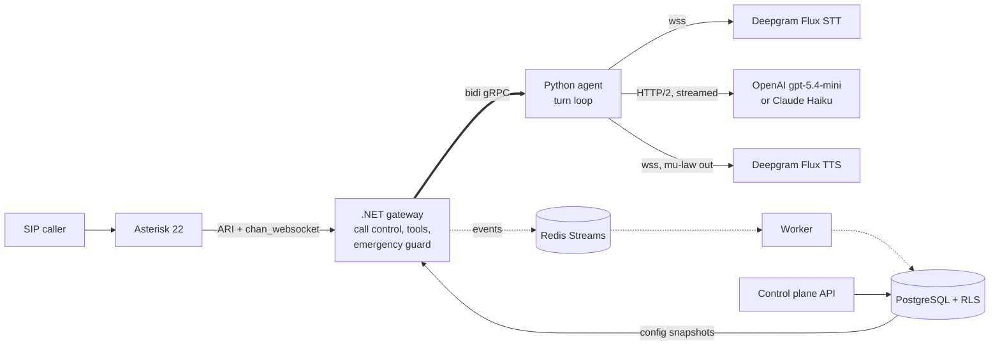

# Switchboard

A multi-tenant AI receptionist for phone calls. Each business gets its own receptionist agent, with its own name, voice and number. The agent answers in a live voice, holds a real conversation and can be interrupted. It answers from the business's own facts, takes messages, books callbacks, puts callers through to the right department and says goodbye. It can also place calls with its own caller ID.

Underneath sits the original call router's decision code. It checks transfers, enforces the emergency guard, and still routes WhatsApp-style messages. A caller the agent can't take goes straight to a person.

All tenants and data are fictional. **This is not an emergency service:** the emergency class exists to demonstrate asymmetric misroute costs.



## How a call goes

1. The call reaches Asterisk, which hands it to the gateway. The number dialled picks the tenant and whether the agent or the router answers.
2. The greeting plays straight away. It was synthesised when the service started, so there's no speech round trip on answer.
3. The caller's audio streams to **Deepgram Flux**, which decides when they've finished from the words and how they're said, not from a silence timer.
4. **Claude** starts on Flux's *early* end-of-turn signal, before the turn is certain. Its words are held until the turn is confirmed, and thrown away if the caller carries on.
5. The reply streams into **Flux TTS** as it's written, and audio goes to the caller as it arrives. It's already in the phone's own format (8 kHz mu-law), so nothing is transcoded.
6. If the caller talks over the agent, its queued audio is flushed at once. Playback marks from Asterisk mean the conversation history holds only what the caller actually heard.
7. Tools are requests: the gateway checks every argument against the tenant before acting. Transfers go through the router's department, hours and voicemail rules.
8. Every caller sentence also goes through the router's emergency lexicon in .NET. A hit cuts the agent off and transfers, whatever the model is doing.
9. After the call, a short summary is written for the business. Messages, callbacks, transcripts and summaries come back through the API.

## Designed for latency

| Where the time goes | What's done about it |
|---|---|
| Knowing the caller has finished | Flux model-based turn detection, about 140 ms after the last word in a live test, against about 770 ms for silence-timer endpointing |
| The model thinking | Speculative start on the early end-of-turn; Haiku with thinking off; short spoken answers; business facts in a cached system prompt, so no lookup round trip |
| Speech | Streamed text in and streamed audio out; first audio about 340 ms after text in a live test from Johannesburg |
| Connections | STT and TTS connect while the greeting plays; a spare TTS socket is kept open, so an interruption never waits for a reconnect |
| Tools | Messages and callbacks are acknowledged at once and persisted asynchronously through Redis |
| The network | In production, run Asterisk, the gateway and the agent in the providers' region. Each provider hop from South Africa costs a WAN round trip |

Every agent turn records its end-of-turn, first-token, first-audio and voice-to-voice times as an event.

**Choosing the brain.** `AGENT_LLM` picks `openai` or `anthropic`. `bench/agent_brain_eval.py` runs the real prompt on cases that matter on a phone: a garbled caller must get a question, not a transfer; an emergency must transfer to the right place; prices come from the business facts; nothing is invented. On 16 runs, gpt-5.4-mini and gpt-4.1 got all 16 right with a first word in about 825 ms. gpt-4.1-mini sent a garbled caller to the emergency vet twice, so it isn't the default.

**Local voice versus Deepgram.** `bench/tts_compare.py` streams the same replies word by word into each engine. On a 15 W laptop CPU (i7-1355U), Kokoro's first audio came about 0.9 to 1.1 s after the first word, against about 0.46 s for Deepgram Flux over the network from Johannesburg, and Kokoro ran at only 1.4 times real time. Kokoro is now off by default (`--profile kokoro`).

**ElevenLabs.** `bench/elevenlabs_probe.py` times `eleven_flash_v2_5` the same way. In auto mode it started in about 0.28 s, but only when sent whole phrases: sent word by word, it voiced each word separately and a 7 s sentence came out as 13.4 s. The adapter sends phrases. Its free plan allows four requests at a time, and each call holds two sockets.

## Call it from your phone

You don't need a phone number from a carrier to try it. A free SIP softphone on the same Wi-Fi works:

1. In `.env`, set `HOST_LAN_IP` to this machine's LAN address, `PHONE_SIP_PASSWORD`, and `ASR_MODE=live`. Then run `uv run poe stack-up` and `uv run poe seed`.
2. In Linphone or Zoiper, add a **third-party SIP account**: username `phone`, your password, domain `HOST_LAN_IP`, transport UDP. On iOS, allow Linphone **local network** access.
3. Dial:

| Dial | Who answers |
|---|---|
| `101` to `105` | The receptionist agent for each tenant: Gemma (animal hospital), Sienna (utilities), Colin (fibre internet), Hannah (school), Kit (insurance broker) |
| `106` to `110` | The same receptionists with an ElevenLabs voice (Alice, Sarah, George, Bella, Chris) instead of Deepgram's |
| `600` | Echo test: you hear yourself |

Press `0` at any time to reach a person. To play the staff member, sign a second softphone in as `desk` (password `DESK_SIP_PASSWORD`): every transfer rings it, labelled with the department. Without it, departments are a SIPp stand-in that answers and stays silent.

To have the agent phone you: `POST /v1/agent/calls` with `{"destination": "softphone", "purpose": "...", "consent": true}` and a tenant key. A real number needs a SIP trunk (`OUTBOUND_TRUNK`), and consent is always required.

## The ideas worth reading

- **The agent talks; the router decides.** Python listens, thinks and speaks. .NET owns the call, the tenant's data, tool execution and the emergency guard. The model can ask for a transfer, but it can't reach a department this tenant doesn't have.
- **The history is what the caller heard.** Interrupted turns are cut where playback stopped, so the model never assumes the caller heard something they didn't.
- **Decisions minimise expected misroute cost,** using calibrated probabilities and a cost matrix, not a top-1 confidence threshold. At 70% between billing and sales, routing is fine because a wrong guess is cheap. At 90% on an appointment with 10% on emergency, it isn't. See `DecisionEngine.cs` and `docs/adr/0002`.
- **Invariants are rules, not costs.** Property tests showed expected cost alone sends a 6% emergency to voicemail, so a hard guard sits on top.
- **Isolation is proved adversarially.** `scripts/mutation_check.py` removes each control in turn and requires a named test to fail. The agent's message and callback tables are in the same suite.
- **Degradation is designed.** If the agent can't start, the caller goes straight to a person. If the model fails mid-call, the agent apologises and transfers. If inference is down, rules and the keypad still route.
- **The failures are written down.** [docs/failure-log.md](docs/failure-log.md) has the real ones, including the design's own.

## Status

| Works and is tested on real infrastructure | Written and tested against fakes only | Needs credentials or people |
|---|---|---|
| Agent calls through Asterisk from a softphone, with live Flux STT and TTS | The agent's turn loop with Claude: speculation, barge-in, tools, silence | Live agent conversations with Claude, and their measured voice-to-voice latency |
| Barge-in, early-audio capture and the model-failure handoff on a live call | Outbound calls placed through the agent | isiZulu and Afrikaans agents: Flux has neither |
| Real SIP calls through Asterisk, including real speech into Whisper | LLM fusion in a real cascade, and speculative calls in the gateway | isiZulu quality on telephone audio |
| Whisper failover when Deepgram is unreachable | Open-weight data generator | LLM-only and cascade results on reportable data |
| Decision engine in .NET and Python, with shared vectors | | Reportable data and native-speaker review |
| Row-level security, API, isolation suite, mutation check | | Encoder bake-off, which needs that data and a GPU |
| Webhook signatures, dedup and tenancy | | The pre-registered `T_route` on live ASR |
| Failure injection, link chaos and load testing | | Sealed test evaluation |
| Per-tenant trace sinks, and traces in self-hosted Langfuse | | Licensed isiZulu and Afrikaans voices |
| LLM client against the live API, with latency measured | | |
| Deepgram on real SIP calls, using synthetic speech | | |

The main accuracy, cost and latency claims are still open, and the test split is sealed. **Fixture numbers test the pipeline and aren't results.**

## Run it

Needs Docker, the .NET 10 SDK and [uv](https://docs.astral.sh/uv/). The Asterisk image builds from source, which takes a while the first time.

```sh
cp .env.example .env              # then set real values
uv sync --python 3.12
uv run poe proto
uv run poe prompts                # needs: docker build -t switchboard/tools deploy/tools
uv run poe stack-up
uv run poe seed
uv run poe e2e                    # five tenants on real SIP calls, the webhook path, canary scans
```

| Command | What it does |
|---|---|
| `uv run poe ci` | Lint, tests, isolation suite, fixture eval, the gate and its self-test |
| `uv run poe mutation` | Removes each control and requires a test to fail (slow) |
| `uv run poe failure` | Stops inference, Postgres and Redis during real calls |
| `uv run poe chaos` | Adds latency and throttling on the inference link |
| `uv run poe traces` | Proves spans stay in their own tenant's sink |
| `uv run poe real-asr` | Real speech into Whisper, Deepgram failover, early commit |
| `uv run poe load` | Open-loop SIP load |
| `uv run poe ablate` | Offline gate, training-size, noise and prefix ablations |
| `uv run poe report` | Regenerates `docs/REPORT.md` |

`poe real-asr` also needs `poe train-tfidf` and the ML extras (`uv sync --extra whisper --extra onnx`).

### With credentials

Put keys in `.env`. These spend real money, and each has a spend cap or a small default size:

| Command | Answers |
|---|---|
| `scripts/spike_deepgram_language.py` | Does isiZulu work on telephone audio? The assumption most likely to change the design |
| `scripts/spike_llm_latency.py` | Does an LLM fit the latency budget? |
| `scripts/make_sapi_clips.py` | Synthetic clips for the next command, using Windows voices. Latency only |
| `bench/live_ablations.py` | Endpointing against premature routing, what region is worth, and the head start speculative calls could get |
| `uv run poe live-call` | Real SIP calls through live Deepgram, with an estimated time to route |
| `uv run poe live-eval` | LLM-only and cascade arms, with answers cached |
| `python -m switchboard_inference.data.generate` | Reportable data from an open-weight model |

## Layout

```text
proto/          gRPC and event contracts
configs/        cost matrix, tenants, lexicon, prompts, LLM settings
src/dotnet/     Domain (pure), Storage (RLS), Api, Gateway, Worker
src/python/     inference server, receptionist agent, ASR, intent, LLM, data, evals, training
tests/          dotnet (unit, isolation, architecture), python, e2e
deploy/         Compose, Asterisk, SIPp, OTel Collector, Langfuse
bench/          load and stage benchmarks
docs/           metrics, rubric, ADRs, model and data cards, failure log, report, evidence
```

## Limits

- No real SIP trunk, WhatsApp API or customers. Without a trunk, the agent can only call the softphone. Testing uses SIPp, and a softphone on the LAN.
- The agent speaks English only: Deepgram Flux has no isiZulu or Afrikaans. Those callers can use the router, which handles all three.
- **No tested LLM fits the 550 ms reserve.** On a live call, a synchronous escalation would hit its deadline and fall back to clarifying. Speculative calls don't recover it: on synthetic speech with live Deepgram partials, even the upper bound rarely gives a median Haiku answer enough head start. See entry 16 in the failure log.
- Whisper has no isiZulu or isiXhosa, so the fallback is a declared degraded mode with a keypad menu. On CPU it also won't reliably meet a 1.5 s budget.
- The router's fixed prompts use a robotic stand-in voice, and isiZulu prompts are spoken with an English voice. The agent uses Flux voices.
- The rubric and the isiZulu and Afrikaans phrases haven't had human or native-speaker review.
- Design differences from the original intent are listed in `docs/adr/0003`.
